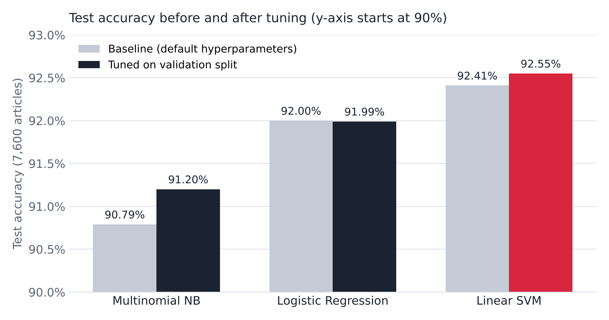
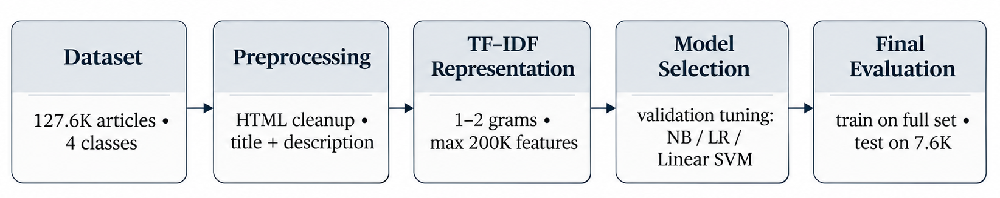
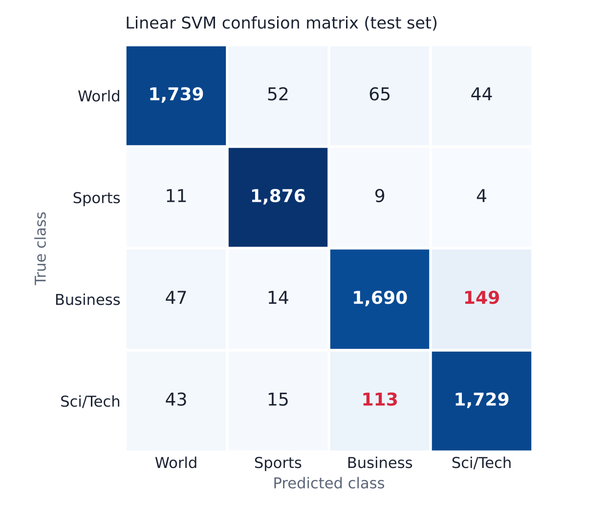

<div align="center">

# AG News Text Classification with Classical Machine Learning

**Topic classification of 127,600 news articles using TF-IDF features and three linear and probabilistic classifiers**

*Big Data Analytics and Text Mining*


</div>

---

## Abstract

This project studies large-scale, multi-class text classification on the **AG News** corpus, which contains 127,600 news articles in four balanced categories: *World*, *Sports*, *Business* and *Sci/Tech*. Article titles and descriptions are cleaned of HTML artefacts, concatenated, and represented as a 200,000-dimensional sparse TF-IDF matrix of word unigrams and bigrams. Three classical algorithms are compared: **Multinomial Naive Bayes**, **Logistic Regression** and a **Linear Support Vector Machine**. Hyperparameters are selected on a stratified validation split, and the official test set is used only once, for the final evaluation.

**Linear SVM achieves the best result, with 92.55% test accuracy and a macro-F1 of 0.925, and trains in about two seconds.** Nearly half of the remaining errors are confusions between *Business* and *Sci/Tech*, two categories that share vocabulary about companies, markets and technology.

## Contents

- [Key results](#key-results)
- [Dataset](#dataset)
- [Methodology](#methodology)
- [Detailed results](#detailed-results)
- [Course requirements](#course-requirements)
- [Getting started](#getting-started)
- [Repository structure](#repository-structure)
- [Limitations and future work](#limitations-and-future-work)
- [References](#references)

## Key results

Test-set performance after hyperparameter tuning (7,600 held-out articles, 1,900 per class):

| Model | Selected hyperparameters | Accuracy | Macro-F1 | Training time |
|:---|:---|---:|---:|---:|
| **Linear SVM** | C = 0.5 | **92.55%** | **0.9254** | ≈ 2 s |
| Logistic Regression | C = 5 | 91.99% | 0.9197 | ≈ 20 s |
| Multinomial Naive Bayes | α = 0.03 | 91.20% | 0.9117 | < 0.1 s |

<p align="center">
  
</p>

Training times were measured on a single CPU and are indicative only.

## Dataset

| Property | Value |
|:---|:---|
| Source | [`sh0416/ag_news`](https://huggingface.co/datasets/sh0416/ag_news) on Hugging Face (Zhang et al., 2015) |
| Documents | 127,600 (official split: 120,000 training, 7,600 test) |
| Classes | World, Sports, Business, Sci/Tech, perfectly balanced |
| Fields | `label`, `title` (≈ 7 words), `description` (≈ 31 words) |

The notebook downloads the data automatically. If the Hugging Face Hub is unavailable, it falls back to a GitHub CSV mirror of the same corpus.

## Methodology



1. **Cleaning.** HTML entities left in the raw crawl (for example `#39;` and `&lt;b&gt;`) are decoded, tags and backslashes are removed, and the title and description are joined into one text field.
2. **Exploratory analysis.** Class balance, document-length statistics by class, and the highest-weighted TF-IDF terms per class.
3. **Feature extraction.** Sublinear TF-IDF with English stop-word removal, `min_df = 2` and a cap of 200,000 unigram and bigram features. The vectoriser is fitted on training text only.
4. **Model selection.** A stratified 10% validation split is drawn from the training set, and the vectoriser is refitted on the remaining 90% to avoid leakage. The search covers:
   - n-gram range: (1,1), (1,2), (1,3)
   - Naive Bayes smoothing α ∈ {1, 0.3, 0.1, 0.03, 0.01}
   - Logistic Regression C ∈ {0.5, 1, 5, 10}
   - Linear SVM C ∈ {0.1, 0.5, 1, 2}
5. **Evaluation.** Each model is refitted on all 120,000 training documents with its selected settings and scored once on the test set using accuracy, macro-F1, per-class precision and recall, and confusion matrices.

All random steps use a fixed seed (`RANDOM_STATE = 42`).

## Detailed results

### Validation: n-gram range

Measured with Linear SVM at default settings.

| n-gram range | Features | Validation accuracy |
|:---|---:|---:|
| (1, 1) unigrams | 39,948 | 0.9210 |
| **(1, 2) unigrams + bigrams** | 200,000 | **0.9268** |
| (1, 3) up to trigrams | 200,000 | 0.9260 |

Bigrams add 0.6 percentage points. Trigrams bring no further gain under the 200,000-feature cap.

### Effect of tuning on the test set

| Model | Baseline accuracy | Tuned accuracy | Change |
|:---|---:|---:|---:|
| Multinomial Naive Bayes | 90.79% | 91.20% | +0.41 |
| Logistic Regression | 92.00% | 91.99% | −0.01 |
| Linear SVM | 92.41% | 92.55% | +0.14 |

For Logistic Regression, the validation gain from C = 5 did not carry over to the test set, which suggests the default setting was already close to optimal.

### Error analysis (Linear SVM)

<p align="center">
  
</p>

| Class | Precision | Recall | F1 |
|:---|---:|---:|---:|
| World | 0.9451 | 0.9153 | 0.9299 |
| Sports | 0.9586 | 0.9874 | 0.9728 |
| Business | 0.9004 | 0.8895 | 0.8949 |
| Sci/Tech | 0.8977 | 0.9100 | 0.9038 |

Of the 566 misclassified test articles, 262 (46%) are Business and Sci/Tech confused with each other. Sports is almost perfectly separated thanks to its distinctive vocabulary.

## Requirements

| Requirement | This project |
|:---|:---|
| N ≥ 20,000 | N = 127,600 documents |
| p ≥ 4 | p = 200,000 TF-IDF features (interpretation approved by the course instructor) |
| n<sub>A</sub> ≥ 3 | Multinomial Naive Bayes, Logistic Regression, Linear SVM |
| N × p ≥ 10<sup>6</sup> | 127,600 × 200,000 ≈ 2.55 × 10<sup>10</sup> |

## Getting started

**Prerequisites:** Python 3.12 or later and an internet connection for the first download of the dataset.

```bash
git clone https://github.com/kawsarfarooq/AG-News-Text-Classification-with-Classical-ML.git
cd AG-News-Text-Classification-with-Classical-ML

python -m venv .venv
source .venv/bin/activate          # Windows: .\.venv\Scripts\Activate.ps1

pip install -r requirements.txt
jupyter notebook ag_news_classification.ipynb
```

Select **Run All**. A full run takes about 5–10 minutes on a modern laptop; the Logistic Regression sweep is the slowest step. The notebook is self-contained and needs no extra data files.

## Repository structure

```
.
├── ag_news_classification.ipynb   # Complete analysis: data, EDA, features, models, evaluation
├── Figures/                        # Figures used in this README
├── requirements.txt               # Python dependencies
└── README.md
```

## Limitations and future work

- TF-IDF ignores word order and context beyond two-word phrases, which limits how well it can separate topics with overlapping vocabulary such as Business and Sci/Tech.
- Only linear and probabilistic models were compared. A natural extension is a transformer baseline such as DistilBERT, reported alongside its training time and hardware cost.

## References

1. Zhang, X., Zhao, J., & LeCun, Y. (2015). [Character-level Convolutional Networks for Text Classification](https://proceedings.neurips.cc/paper/2015/hash/250cf8b51c773f3f8dc8b4be867a9a02-Abstract.html). *Advances in Neural Information Processing Systems, 28*.
2. [AG News dataset (`sh0416/ag_news`)](https://huggingface.co/datasets/sh0416/ag_news). Hugging Face.
3. Pedregosa, F. et al. (2011). [Scikit-learn: Machine Learning in Python](https://jmlr.org/papers/v12/pedregosa11a.html). *Journal of Machine Learning Research, 12*, 2825–2830.

---